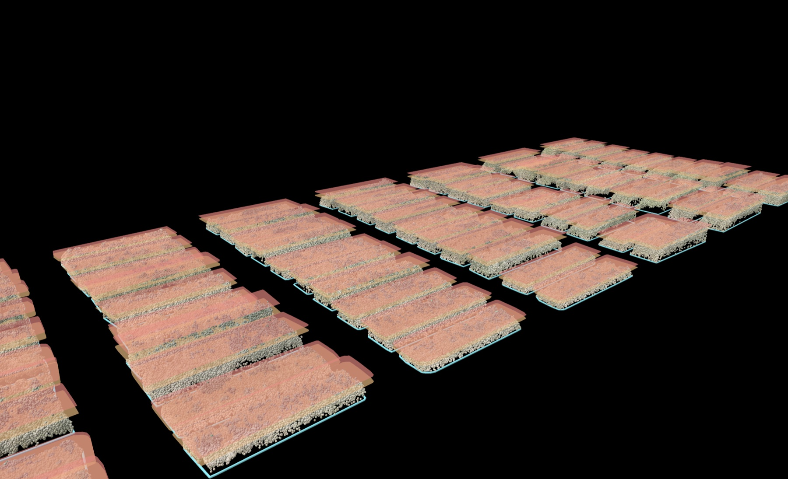
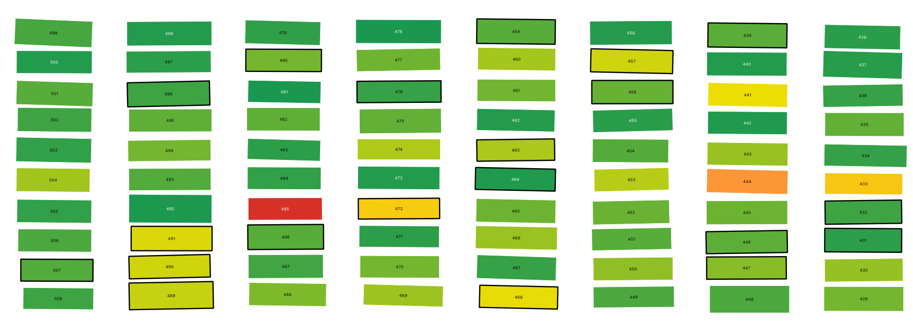
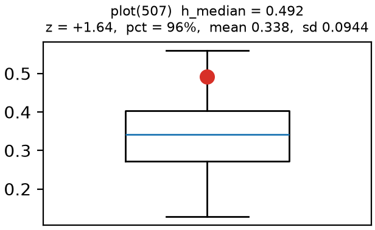
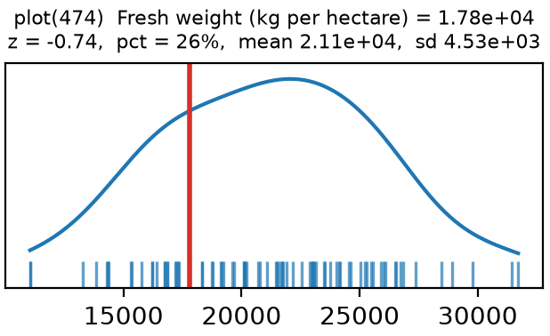
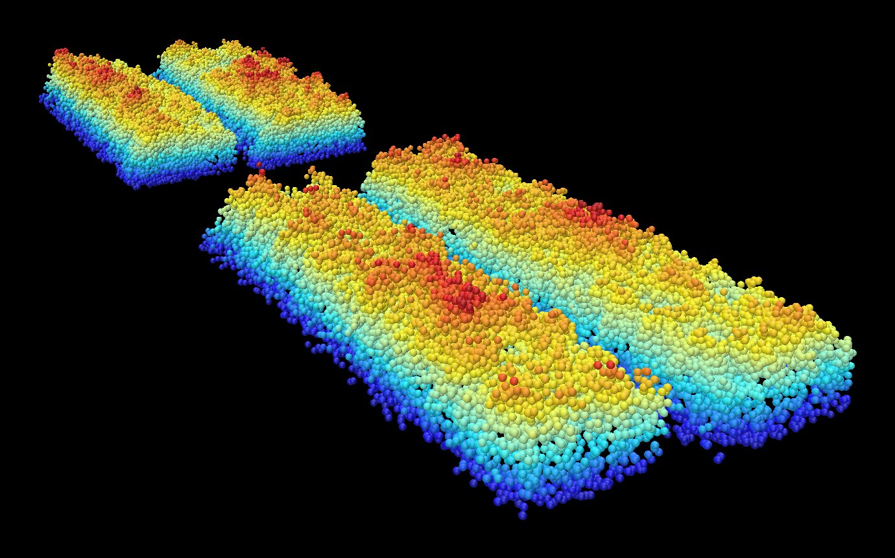

# LiPheno: Wheat Biomass Toolkit

A desktop app for exploring how well crop biomass, or other target values, can be predicted from LiDAR
point clouds of field plots. You load the scans, compute vegetation features
for each plot, train and compare several machine learning models, and see the
results on a map of the field. From the map you can click any plot to open its
3D point cloud.

<p align="center">
  
</p>

> [!NOTE]
> **Status: proof of concept.** LiPheno has been validated on the public SGCBP
> dataset and used on the CYENS data, but it has not been tested extensively:
> not on other datasets, and not across many combinations of settings. It is
> well suited to exploring data, prototyping ideas and getting inspiration.
> Treat new results as a starting point and check them before you rely on
> them. It is not meant to be the sole basis for a scientific publication.

## What it can do

- **Get per-plot point clouds from your data.** Cut one whole-field scan into
  plots using a GeoPackage of plot outlines, or import a folder of clouds that
  are already split by plot (`.las`, `.laz`, `.pcd`).
- **Augment the data (optional).** Make extra training copies of each plot
  with rotation, flips, jitter, point dropout or resampling. Each copy stays
  linked to its original plot, so copies of one plot never end up on both
  sides of a train/test split.
- **Compute vegetation features.** Each plot gets height statistics (mean,
  percentiles, spread, skewness, entropy, penetration ratio, …), mean colour
  when the cloud has RGB, and a set of hand-made features that describe the
  plot's horizontal structure. The height features need a height-above-ground
  value per point, prepared before import (see
  [Before using your own data](#before-using-your-own-data)).
- **Train and compare models.** Ridge, lasso, elastic net, PLS, kNN, SVR,
  random forest, histogram gradient boosting and Gaussian process regression.
  Every model is evaluated with nested cross-validation and Optuna
  hyperparameter search.
- **Explore the results.** Compare models, view predicted vs. measured plots
  and feature importance, and check how stable the results are across splits.
  A field map links every number back to a real plot.

### Results map

Every plot is drawn at its real position in the field and coloured by any
value you pick, such as measured biomass, prediction error or a feature.
Plots that were held out for testing have a thick border.

<p align="center">
  
</p>

Click a plot to see where it sits compared with all other plots, for a
feature or for the target:

<p align="center">
  
  &nbsp;
  
</p>

### 3D viewer

Right-click a plot, or select several, to open it in a
[Polyscope](https://polyscope.run/) window. Clouds can be coloured by original
RGB, by relative height, or by the same value shown on the map. The geometry
behind the hand-made features can be drawn on top.

<p align="center">
  
</p>

## How the app is organised

The app has six pages that you work through from left to right. Each page
passes its output on to the next.

| Page | What it does |
| --- | --- |
| **Project** | Create or open a project folder and choose a preset (see [Presets](#presets)). |
| **Import** | Get per-plot clouds into the project, either by clipping a field cloud with plot outlines or by importing a folder of per-plot files. Also load the ground-truth table. |
| **Augment** | Optional. Make augmented copies of each plot. |
| **Features** | Compute the vegetation features for every plot and save them as a table. |
| **ML** | Join the features to the ground truth and train the models. |
| **Results** | Compare models and explore the results on the field map and in 3D. |

Plot numbers are read from the source data, not assigned by the app, so the
results always line up with the real field.

## Feature types

Each plot is reduced to one row of numbers. You can turn every feature on or
off on the Features page.

| Type | What it describes | Examples |
| --- | --- | --- |
| **Height** | The vertical make-up of the canopy, based on each point's height above ground. | Mean, median, max and percentile heights; variance and coefficient of variation; skewness and kurtosis; vertical entropy; surface roughness; share of points above the mean; pulse penetration ratio (how many pulses reach the ground) |
| **Colour** | Average point colour. Only for clouds that carry RGB, such as CYENS. | Mean red, green and blue |
| **Horizontal structure ("2D")** | How the points are spread across the plot, measured along the plot's own long and short axes, so the result doesn't depend on how the plot is rotated. | Spread and elongation; front/back and left/right imbalance; angle between the top and bottom of the canopy; roughness along each axis |
| **Reference data** | Optional extra columns from your ground-truth spreadsheet, matched to plots by plot number. Category columns can be split into separate yes/no columns. | Variety, species, block, heading date |

The full list of feature keys is printed at the top of
[`presets.txt`](presets.txt). See [Acknowledgements](#acknowledgements) for
where the definitions come from.

## Code structure

```
LiPheno/
├── main.py            Starts the app
├── presets.txt        Ready-made settings per dataset (editable)
├── gui/               The desktop interface: one file per page
│   └── results/       The Results tabs: field map, model comparison, plots
├── clip/              Clipping a field cloud with plot outlines, importing per-plot files
├── augment/           Augmentation methods and the record of which copy came from which plot
├── featuregen/        Feature definitions and the code that computes them
├── ml/                Datasets, train/test splitting, models, nested CV, metrics
│   └── models/        One file per model type
├── common/            Shared helpers: project folder, settings, file I/O, plot naming
├── tools/             Standalone scripts: the 3D viewer, a plot-outline fix-up tool
├── tests/             Automated tests (pytest)
├── docs/images/       Screenshots used in this README
└── Data/              The two example datasets (see below)
```

Some useful starting points:

- **Adding a feature:** all features live in one list in
  [`featuregen/features.py`](featuregen/features.py). The app builds its
  checkboxes from that list, so a new entry shows up in the interface
  automatically.
- **Adding a model:** each model is a small file in [`ml/models/`](ml/models/)
  that declares its estimator and search space.
- **The 3D viewer** runs as a separate process
  ([`tools/view_laz.py`](tools/view_laz.py)) so the OpenGL window never clashes
  with the Qt interface.

## Datasets

The repository includes two datasets, so you can run the whole workflow right
after cloning.

### SGCBP (Yanco, Australia, 2019)

The *Small Grain Cereals Biomass Prediction* dataset was published by CSIRO
together with the BioNet paper (Pan et al., 2022). It covers 26 varieties of
wheat and triticale grown at Yanco, NSW, in 2019. Each variety was sown at two
densities (250 and 50 seeds/m²) to get a wide range of biomass values and plant
shapes.

- **LiDAR:** scanned from about 2 m above the canopy with the
  PhenoMobile-Lite, a hand-pushed field buggy. Every plot was scanned twice:
  on 2019-08-28 (early, vegetative stage, Z31) and on 2019-10-02 (flowering,
  Z65).
- **Ground truth:** right after each scan, the plants in part of each plot
  were cut at ground level (1 m² early, 0.5 m² at flowering), oven-dried at
  70 °C and weighed. Biomass is given as dry weight in g/m².
- **In this repo:** the original files plus a reformatted copy split by scan
  date (156 early and 150 late plots with ground truth). See
  [`Data/SGCBP/README.md`](Data/SGCBP/README.md) for details and the list of
  changes.

Data licence: CC BY 4.0.

> Estavillo, G., Condon, A., Pan, L., Bull, G. & Coe, R. (2021). *Biomass and
> LiDAR data from wheat and triticale plots grown at Yanco (NSW) in 2019 to
> improve prediction of digital biomass.* v2. CSIRO Data Collection.
> https://doi.org/10.25919/xv6v-6h56
>
> Pan, L., Liu, L., Condon, A. G., Estavillo, G. M., Coe, R. A., Bull, G.,
> Stone, E. A., Petersson, L. & Rolland, V. (2022). Biomass Prediction with 3D
> Point Clouds from LiDAR. *IEEE/CVF Winter Conference on Applications of
> Computer Vision (WACV)*, 1330–1340.

### CYENS (Nicosia, Cyprus, 2025)

A forage (hay) trial from the 2024–2025 season: 10 bread wheat
and 10 triticale genotypes in 80 plots, laid out in four replicate blocks.

- **LiDAR:** weekly drone flights with a DJI Zenmuse L2 (with RGB), from
  late February to early April 2025.
- **Ground truth:** fresh and dry biomass (kg/ha) and plant height, measured
  just before harvest. The CYENS preset uses **fresh weight** as the target.
- **In this repo:** only the LiDAR from the last flight before harvest
  (2025-04-03), pre-processed in
  [CloudCompare](https://www.cloudcompare.org/) to add a *relative height*
  (height above ground) to every point. Also included: a GeoPackage of plot
  outlines and the field measurements spreadsheet.

> *AI-Driven Multi-Temporal UAV LiDAR-Multispectral Data Fusion for
> High-Throughput Phenotyping of Forage Wheat Genotypes under Mediterranean
> Conditions.*
> <!-- TODO: add authors, year and venue / DOI once published. -->

## Presets

[`presets.txt`](presets.txt) holds ready-made settings for each dataset
(`CYENS`, `SGCBP 2019-08-28`, `SGCBP 2019-10-02`). A preset fills in the file
paths, how plot numbers are read from file names, which features are on, the
target column and the split settings. Choose one on the Project page. To
create your own, copy the `[default] { … }` block and edit it. The comments in
the file explain every setting.

## Getting started

Requires **Python 3.12** (developed on 3.12.10).

```bash
python -m venv .venv

# macOS / Linux
.venv/bin/python -m pip install -r requirements.txt
.venv/bin/python main.py

# Windows
.venv\Scripts\python.exe -m pip install -r requirements.txt
.venv\Scripts\python.exe main.py
```

Then pick a preset on the Project page and work through the pages from left
to right.

### Before using your own data

> [!NOTE]
> **Height above ground must be prepared beforehand.** LiPheno does not
> calculate ground height itself. Every point needs a height-above-ground
> value before you import the clouds, for example a relative height field
> added in [CloudCompare](https://www.cloudcompare.org/), as was done for the
> CYENS data. If your Z values are already measured from the ground, as in
> the SGCBP data, you can use Z directly. You choose the field in the
> *Height channel* dropdown on the Features page.

### Running the tests

```bash
.venv/bin/python -m pip install -r requirements-dev.txt
.venv/bin/python -m pytest
```

The tests run on all CPU cores by default (via `pytest-xdist`). Add `-n 0` to
run them in a single process, for example when debugging.

## Acknowledgements

- The **height features** follow the metric definitions in
  [LiDAR_Vegetation_Metrics](https://github.com/Jinhu-Wang/LiDAR_Vegetation_Metrics)
  by Jinhu Wang (MIT licence). That project computes the metrics on a raster
  grid; here each one is computed once per plot. We made two small changes,
  both marked in the code: the coefficient of variation uses the sample
  standard deviation, and slightly negative heights are included when
  computing entropy. The **colour** and **horizontal-structure ("2D")
  features** were made for this project.
- The **3D visualisations** are built on
  [Polyscope](https://polyscope.run/) by Nicholas Sharp and contributors
  (Sharp, N. et al. (2019). *Polyscope*. www.polyscope.run).
- The **SGCBP data** was collected by CSIRO and the Australian Plant Phenomics
  Facility; see the citations above.
- The **CYENS data** comes from the field trial described under
  [CYENS (Nicosia, Cyprus, 2025)](#cyens-nicosia-cyprus-2025), part of the EU-funded PHENOWEX and
  PHENOTYPOS projects.
- This project was developed with the help of
  [Claude Code](https://claude.com/claude-code), Anthropic's AI coding
  assistant.

## Licence

The source code is MIT licensed; see [`LICENSE`](LICENSE). The data in
`Data/SGCBP/` is licensed separately under CC BY 4.0.
<!-- TODO: add the licence / terms of use for Data/CYENS/. -->
